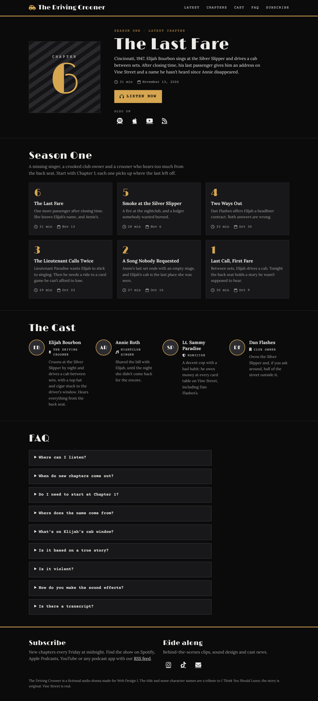
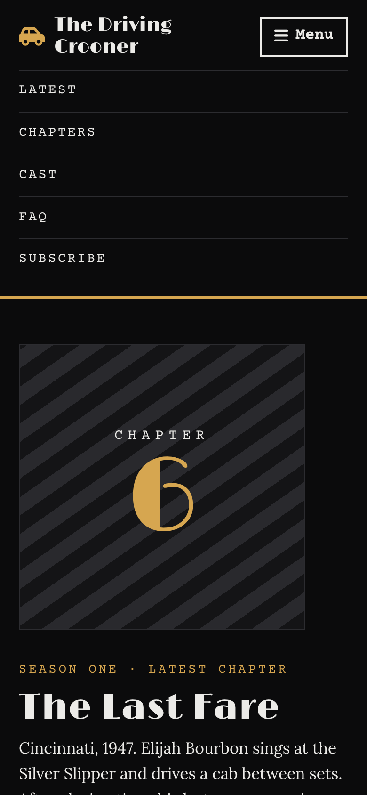

# 🚕 The Driving Crooner: Icons and a Mobile Menu

## 🎯 Overview

The Driving Crooner is a noir audio drama set in Cincinnati in 1947. Its website is already built: the HTML and the
base styles are done. Your job is to finish it. Add icons throughout the page, add a transition to the links, then
make the **Menu** button open and close the navigation on phones. You'll practice using an icon library, writing
accessible labels for icon-only links, native interactive elements, CSS transitions, and toggling a page element with
JavaScript.

## 📋 Requirements

### Icons

- [ ] Load [Font Awesome](https://fontawesome.com/) in the `<head>` of `index.html`.
- [ ] Add an icon to every spot shown in the example screenshots below:
  - [ ] A car next to the site name in the header
  - [ ] A menu (hamburger) icon in the **Menu** button
  - [ ] A clock next to each length and a calendar next to each date, in the latest chapter and on all six chapter cards
  - [ ] Headphones in the **Listen now** button
  - [ ] Spotify, Apple, YouTube and RSS icons for the **Also on** links
  - [ ] An icon that fits each cast member's role (for example, a microphone for the crooner)
  - [ ] Instagram, TikTok and email icons in the footer
- [ ] Links that show only an icon (**Also on** and the footer) keep their text for screen readers inside a
  ``. `base.css` already defines the `.visually-hidden` class.

### FAQ

- [ ] The FAQ near the bottom of the page is already built with `details` and `summary`. Open and close each question
  with a click, then with the keyboard (<kbd>Tab</kbd> to a question, then <kbd>Enter</kbd>). Don't add JavaScript to
  it: the browser already handles the clicking, the keyboard, and telling screen readers whether it's open.

### Transitions

- [ ] In `css/style.css`, the header navigation links and the **Also on** links change color on `:hover` and
  `:focus-visible`, using a color variable from `base.css`.
- [ ] Add a short `transition` on the links themselves (not on the `:hover` rule), so the color fades in and back out.

### Mobile menu

- [ ] On screens narrower than `48rem`, show the **Menu** button and hide the navigation links.
- [ ] Clicking **Menu** shows the links; clicking it again hides them.
- [ ] Each click toggles an `is-open` class on the `nav` with `classList.toggle()`, and your CSS shows the
  links only when the `nav` has that class.
- [ ] At `48rem` and wider, hide the **Menu** button and always show the links in a row across the header.

### Files

- [ ] Do **not** edit `css/base.css`. Put your styles in `css/style.css` and link it **after** `base.css`.
- [ ] Put your JavaScript in `js/script.js` and load it from `index.html`.
- [ ] Don't change the page's text or rearrange its sections. `base.css` styles some elements by their position in
  the page, so moving them can break the layout.

## 🖼️ Example Output

**Desktop:**

**Phone, with the menu open:**

When the menu is closed, the header shows only the site name and the **Menu** button.

## 📂 Starter Files

| File / Folder   | Purpose                                                     |
|-----------------|-------------------------------------------------------------|
| `index.html`    | The finished page markup. Add your icons, styles and script here. |
| `css/base.css`  | Provided styles. **Don't edit.**                            |
| `css/style.css` | **You create.** Your transitions and mobile menu styles.    |
| `js/script.js`  | **You create.** The code that opens and closes the menu.    |
| `images/`       | Example screenshots of the finished page.                   |

## 🧮 Grading

| Criteria                                                                                   | Points |
|--------------------------------------------------------------------------------------------|--------|
| Font Awesome loads, and every icon from the screenshots is present                         | 5      |
| Icon-only links keep their text inside a `visually-hidden` span                            | 4      |
| Menu opens and closes on phones by toggling the `is-open` class                            | 5      |
| Desktop header shows the links in a row and hides the button                               | 3      |
| Header and **Also on** links fade to a new color on hover and focus with a `transition`    | 1      |
| `base.css` unchanged; styles in `css/style.css`, script in `js/script.js`                  | 1      |
| **Total**                                                                                  | **19** |

## 📚 Resources

- [Font Awesome: Add icons with HTML](https://docs.fontawesome.com/web/add-icons/how-to)
- [MDN: `classList`](https://developer.mozilla.org/en-US/docs/Web/API/Element/classList)
- [MDN: `addEventListener()`](https://developer.mozilla.org/en-US/docs/Web/API/EventTarget/addEventListener)

## 🆘 Getting Help

Ask during class or office hours, or post on the Canvas discussion board.

---

The AI policy and submission instructions are in the [README](../README.md).
